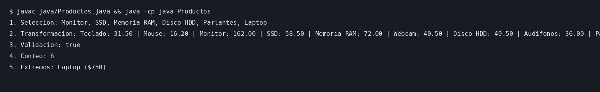
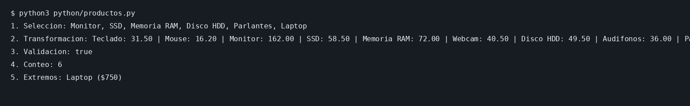

# Funciones anónimas en Scala, Java y Python

**Materia:** Programación Funcional  
**Actividad:** Trabajo de consulta: funciones anónimas

## Introducción

Las funciones anónimas permiten expresar operaciones pequeñas sin tener que declarar una función diferente para cada tarea. En este trabajo se revisan dos usos reales, se explican los conceptos básicos y se resuelven cinco problemas con una lista de productos. Después se estudian cuatro operaciones nuevas de Scala y se comparan los tres lenguajes.

## Contenido

1. [Explorar: programación funcional en proyectos reales](#1-explorar-programación-funcional-en-proyectos-reales)
2. [Entender: conceptos fundamentales](#2-entender-conceptos-fundamentales)
3. [Aplicar: cinco tipos de problemas](#3-aplicar-cinco-tipos-de-problemas)
4. [Ampliar: operaciones nuevas en Scala](#4-ampliar-operaciones-nuevas-en-scala)
5. [Comparar y concluir](#5-comparar-y-concluir)

Al final se encuentran las instrucciones de ejecución y las referencias consultadas.

## 1. Explorar: programación funcional en proyectos reales

Las funciones anónimas no se usan únicamente en ejercicios de clase. Aparecen en herramientas para analizar datos y en bibliotecas que permiten procesar colecciones de manera más sencilla. Se investigaron dos casos: Apache Spark y los Streams de Java.

### 1.1. Caso real: Apache Spark

#### ¿Qué es Apache Spark?

Apache Spark **no es una empresa**. Es un motor de procesamiento de datos de código abierto, desarrollado como proyecto de la Apache Software Foundation. Sirve para trabajar con grandes volúmenes de información, incluso cuando el procesamiento necesita repartirse entre varias computadoras.

Puede utilizarse para limpiar datos, generar reportes, realizar análisis y preparar información para otros sistemas. Spark admite varios lenguajes: **Scala, Java, Python y SQL**. Cuando se utiliza desde Python, se conoce habitualmente como *PySpark*.

#### ¿Qué empresas lo utilizan?

**Uber.** En una publicación de su equipo de ingeniería de junio de 2025, Uber explica cómo migró trabajos de transformación de datos de Hive hacia **Spark SQL**. Estos trabajos apoyan tareas como informes financieros, planificación y análisis de fraude. La empresa buscaba mejorar el rendimiento y simplificar el procesamiento de grandes volúmenes de información.

**Capital One.** Un artículo de su blog de ingeniería explica el uso de **PySpark** junto con **Spline**, una herramienta que permite registrar de dónde vienen los datos y cómo se transforman. Este ejemplo muestra la utilidad de Spark en tareas donde es importante revisar el origen y los cambios de la información.

Es importante distinguir las fuentes: el artículo de Uber describe una implementación con Spark SQL; el de Capital One presenta un caso técnico con PySpark. El ejemplo de función anónima que aparece a continuación es nuestro, no código copiado de esas empresas.

#### ¿Qué problema resuelve?

Una organización puede manejar millones de registros de compras, viajes o transacciones. Procesar toda esa información con procedimientos individuales puede resultar lento o difícil de mantener. Spark permite distribuir el trabajo y definir operaciones sobre los datos sin organizar manualmente cada recorrido.

#### ¿Qué relación tiene con la programación funcional?

Spark dispone de operaciones como `filter` y `map`, que pueden recibir funciones anónimas. Con ellas se indica qué elementos deben conservarse o cómo transformar cada elemento. De esta forma, el código describe **qué operación se quiere realizar**, mientras Spark se ocupa de ejecutar el procesamiento.

**Ejemplo propio en Scala, basado en la API de Spark:**

```scala
val ventas = sc.parallelize(Seq(20, 150, 80))
val grandes = ventas.filter(valor => valor > 100)
```

Aquí `valor => valor > 100` es una función anónima. La operación conserva solo las ventas mayores que 100, por lo que el resultado contiene `150`. Para ejecutar este fragmento se necesita un contexto de Spark llamado `sc`; no forma parte de los programas locales del repositorio.

**Fuentes del caso:** [Apache Spark, sitio oficial](https://spark.apache.org/), [guía de RDD de Spark](https://spark.apache.org/docs/latest/rdd-programming-guide.html), [Uber Engineering](https://www.uber.com/us/en/blog/how-uber-migrated-from-hive-to-spark-sql-for-etl-workloads/) y [Capital One](https://www.capitalone.com/tech/software-engineering/spline-spark-data-lineage/).

### 1.2. Caso real: Streams de Java

#### ¿Qué son los Streams de Java?

Los **Streams de Java** tampoco son una empresa. Son una API incluida en Java (`java.util.stream`) que permite trabajar con elementos de una colección mediante operaciones encadenadas. Por ejemplo, se puede filtrar una lista de pedidos, transformar los valores y obtener una lista con los resultados.

Un *Stream* no es una nueva lista que almacena los elementos; representa una secuencia de procesamiento. Métodos como `filter` y `map` forman pasos intermedios, y una operación final como `toList()` solicita el resultado.

#### ¿Qué proyecto real los utiliza?

Un ejemplo es **Spring Framework**, un proyecto de código abierto que se utiliza para desarrollar aplicaciones en Java. En su código fuente, el archivo `DefaultListableBeanFactory.java` contiene cadenas de Streams que obtienen objetos del sistema y descartan ciertos resultados que no deben incluirse.

Spring Framework es un **producto o framework**, no el nombre de una empresa. Se toma como ejemplo porque su repositorio público permite comprobar directamente el uso de estas funciones en código real.

#### ¿Qué problema resuelven?

En una aplicación puede ser necesario revisar pedidos, seleccionar usuarios activos o transformar una lista de registros. Streams permite escribir esos pasos de manera consecutiva, sin repetir un bucle completo para cada operación.

#### ¿Qué lenguaje utilizan y qué ventaja aportan las lambdas?

Los Streams forman parte de **Java**. Reciben expresiones lambda mediante operadores como `filter` y `map`. Esto hace que una secuencia de selección y transformación sea más fácil de leer. Además, sus operaciones intermedias normalmente se evalúan cuando se ejecuta una operación terminal.

**Ejemplo propio en Java:**

```java
List<Integer> pedidos = List.of(25, 100, 70);
List<Integer> mayores = pedidos.stream()
    .filter(total -> total >= 70)
    .toList();
```

La función anónima `total -> total >= 70` conserva los pedidos de 70 o más. La lista resultante es `[100, 70]`.

**Fragmento real de Spring Framework:**

```java
.map(name -> (T) resolveBean(name, requiredType))
.filter(bean -> !(bean instanceof NullBean));
```

En el código de Spring, `map` obtiene los objetos a partir de sus nombres y `filter` excluye los identificados como `NullBean`. Es parte de una cadena más larga dentro de Spring, por lo que no se ejecuta como un programa independiente.

**Fuentes del caso:** [documentación de Streams de Oracle](https://docs.oracle.com/en/java/javase/21/docs/api/java.base/java/util/stream/Stream.html), [Spring Framework](https://spring.io/projects/spring-framework/) y [código fuente de Spring en GitHub](https://github.com/spring-projects/spring-framework/blob/main/spring-beans/src/main/java/org/springframework/beans/factory/support/DefaultListableBeanFactory.java).

### 1.3. Resumen de los casos investigados

| Caso | Qué es | Uso real | Lenguaje o herramienta | Problema principal |
|---|---|---|---|---|
| Apache Spark | Motor de procesamiento de datos | Uber y Capital One | Spark SQL, Scala, Java y PySpark | Procesar y transformar grandes volúmenes de información |
| Java Streams | API del lenguaje Java | Código fuente de Spring Framework | Java | Filtrar y transformar colecciones mediante operaciones encadenadas |

En ambos casos se observa la misma idea: se define una operación mediante una función y se aplica a un conjunto de elementos. La diferencia es el tamaño del problema. Spark puede procesar datos distribuidos en varias máquinas; Java Streams suele trabajar con datos dentro de una aplicación.

## 2. Entender: conceptos fundamentales

### ¿Qué es una función anónima y por qué se llama lambda?

Es una función escrita directamente donde se necesita, sin declararla con un nombre propio. Se llama *lambda* por el cálculo lambda, un sistema matemático usado para estudiar funciones y su aplicación.

```python
cuadrado = lambda numero: numero * numero
print(cuadrado(4))  # 16
```

En Python se guarda la lambda en una variable para mostrarla, aunque normalmente se usa como argumento de otra operación.

### Diferencia entre función nombrada y anónima

Ambas pueden realizar el mismo cálculo. La nombrada se declara con `def`; la anónima se escribe como una expresión breve.

```python
def duplicar(numero):
    return numero * 2

numeros = [1, 2, 3]
print(list(map(duplicar, numeros)))            # [2, 4, 6]
print(list(map(lambda n: n * 2, numeros)))    # [2, 4, 6]
```

### Funciones como ciudadanos de primera clase

Significa que una función se puede guardar en una variable, pasar como argumento o devolver desde otra función. Por eso `map` y `filter` pueden recibir una lambda: la función se trata como un valor.

```python
numeros = [2, 5, 8]
pares = list(filter(lambda n: n % 2 == 0, numeros))
print(pares)  # [2, 8]
```

### ¿Qué es un closure?

Es una función que conserva acceso a variables de su entorno, incluso cuando se ejecuta fuera del lugar donde se creó.

```python
def crear_descuento(porcentaje):
    return lambda precio: precio * (1 - porcentaje)

aplicar = crear_descuento(0.10)
print(aplicar(100))  # 90.0
```

La función devuelta sigue utilizando `porcentaje`, que fue definido como parámetro de la función exterior.

Fuentes: [Documentación de Python, expresiones lambda](https://docs.python.org/3/reference/expressions.html#lambda) y [Python, Functional Programming HOWTO](https://docs.python.org/3/howto/functional.html).

## 3. Aplicar: cinco tipos de problemas

Se usa el mismo catálogo de diez productos en los tres programas. Cada producto tiene nombre, categoría, precio en dólares y unidades disponibles. El catálogo se encuentra al inicio de `scala/Productos.scala`, `java/Productos.java` y `python/productos.py`.

| Producto | Categoría | Precio ($) | Stock |
|---|---|---:|---:|
| Teclado | Perifericos | 35 | 12 |
| Mouse | Perifericos | 18 | 25 |
| Monitor | Pantallas | 180 | 6 |
| SSD | Almacenamiento | 65 | 15 |
| Memoria RAM | Componentes | 80 | 9 |
| Webcam | Perifericos | 45 | 0 |
| Disco HDD | Almacenamiento | 55 | 4 |
| Audifonos | Audio | 40 | 20 |
| Parlantes | Audio | 70 | 7 |
| Laptop | Computadoras | 750 | 3 |

### 3.1 Selección: productos que cuestan más de $50

**Situación:** una tienda necesita mostrar únicamente los productos cuyo precio supera los $50. Se utiliza `filter` para conservar los que cumplen la condición.

**Scala**
```scala
productos.filter(p => p.precio > 50).map(p => p.nombre)
```
**Java**
```java
productos.stream().filter(p -> p.precio() > 50).map(Producto::nombre).toList();
```
**Python**
```python
list(filter(lambda p: p.precio > 50, productos))
```
**Salida en los tres:** `Monitor, SSD, Memoria RAM, Disco HDD, Parlantes, Laptop` (en Python se imprimen los nombres de los objetos filtrados).

### 3.2 Transformación: descuento del 10 %

**Situación:** la tienda prepara una promoción y necesita calcular el nuevo precio de todos sus artículos. Se utiliza `map` para transformar cada precio.

**Scala**
```scala
productos.map(p => p.precio * 0.9)
```
**Java**
```java
productos.stream().map(p -> p.precio() * 0.9).toList();
```
**Python**
```python
list(map(lambda p: p.precio * 0.9, productos))
```
**Salida en los tres, en el orden original (precios en $):** `31.50, 16.20, 162.00, 58.50, 72.00, 40.50, 49.50, 36.00, 63.00, 675.00`.

### 3.3 Validación: ¿hay productos agotados?

**Situación:** antes de actualizar el catálogo, la tienda revisa si existe algún producto con stock igual a cero. Se obtiene un valor verdadero o falso.

**Scala**
```scala
productos.exists(p => p.stock == 0)
```
**Java**
```java
productos.stream().anyMatch(p -> p.stock() == 0);
```
**Python**
```python
any(map(lambda p: p.stock == 0, productos))
```
**Salida en los tres:** `true` (Python devuelve `True`, que el programa muestra en minúsculas para unificar la salida). La Webcam está agotada.

### 3.4 Conteo: artículos con menos de diez unidades

**Situación:** el encargado quiere saber cuántos productos necesitan revisión de inventario. Se cuenta cada producto cuyo stock es menor a diez.

**Scala**
```scala
productos.count(p => p.stock < 10)
```
**Java**
```java
productos.stream().filter(p -> p.stock() < 10).count();
```
**Python**
```python
sum(map(lambda p: int(p.stock < 10), productos))
```
**Salida en los tres:** `6`.

### 3.5 Extremos: producto más caro

**Situación:** la tienda necesita identificar el artículo con mayor precio. La lambda indica que el criterio de comparación es `precio`.

**Scala**
```scala
productos.maxBy(p => p.precio)
```
**Java**
```java
productos.stream().max((a, b) -> Double.compare(a.precio(), b.precio())).orElseThrow();
```
**Python**
```python
max(productos, key=lambda p: p.precio)
```
**Salida en los tres:** `Laptop ($750)`.

### Resultados de ejecución

Los archivos completos imprimen los cinco resultados en el mismo orden. Se incluyen las capturas de Java y Python, verificadas al ejecutar los programas, y las salidas de texto correspondientes.





La ejecución de Scala queda pendiente de comprobar en un equipo con Scala instalado. El archivo `scala/salida_esperada.txt` contiene la salida calculada con los datos del catálogo, pero **no es una captura de ejecución**.

## 4. Ampliar: operaciones nuevas en Scala

Los siguientes ejemplos se encuentran en `operaciones/Operaciones.scala`. Usan la lista de la [Parte 3](#3-aplicar-cinco-tipos-de-problemas).

### 4.1 `sortBy`: ordenar por un criterio

Ordena los elementos según el valor que devuelve una lambda. En este caso recibe `p => p.precio`, que devuelve un número (`Double`). **Problema:** mostrar un catálogo de menor a mayor precio. Se relaciona con la búsqueda de extremos, pero aquí se ordena toda la colección.

```scala
productos.sortBy(p => p.precio)
```
**Salida (nombres):** `Mouse, Teclado, Audifonos, Webcam, Disco HDD, SSD, Parlantes, Memoria RAM, Monitor, Laptop`.

### 4.2 `groupBy`: agrupar por categoría

Crea grupos usando la clave que devuelve una lambda. `p => p.categoria` devuelve una cadena (`String`). **Problema:** conocer cuántos artículos distintos tiene cada categoría. Es un problema de agrupación, relacionado con el conteo.

```scala
productos.groupBy(p => p.categoria)
```
**Salida resumida, con las categorías ordenadas para mostrarla:** `Almacenamiento=2, Audio=2, Componentes=1, Computadoras=1, Pantallas=1, Perifericos=3`.

### 4.3 `partition`: separar en dos grupos

Divide la lista en elementos que cumplen y no cumplen una condición. La lambda `p => p.stock > 0` devuelve `Boolean`. **Problema:** separar artículos disponibles de agotados. Es parecido a selección, pero conserva ambos grupos.

```scala
productos.partition(p => p.stock > 0)
```
**Salida:** `disponibles=9, agotados=1`.

### 4.4 `find`: localizar el primer elemento que cumpla

Busca el primer producto que satisface una condición. La lambda `p => p.precio < 20` devuelve `Boolean`. **Problema:** encontrar rápidamente una opción económica. Es similar a selección, pero devuelve un único resultado opcional (`Option`).

```scala
productos.find(p => p.precio < 20)
```
**Salida:** `Mouse`.

### 4.5 Combinación de operaciones

**Pregunta:** ¿qué categorías acumulan más de veinte unidades en stock y cómo se ordenan de mayor a menor stock total?

```scala
val categorias = productos.groupBy(p => p.categoria)
  .toList
  .filter(par => par._2.map(p => p.stock).sum > 20)
  .sortBy(par => -par._2.map(p => p.stock).sum)
  .map(par => par._1 + "=" + par._2.map(p => p.stock).sum)
```

Primero `groupBy` reúne productos de una misma categoría. Después `filter` conserva las categorías que superan veinte unidades sumadas. Finalmente `sortBy` las ordena por stock descendente; el último `map` prepara el texto de salida.

**Salida:** `Perifericos=37, Audio=27`.

Fuentes: [Scala Collections: operaciones sobre colecciones](https://docs.scala-lang.org/overviews/collections-2.13/seqs.html) y [API de Scala, List](https://www.scala-lang.org/api/2.13.16/scala/collection/immutable/List.html).

## 5. Comparar y concluir

### 5.1 Comparación entre lenguajes

| Criterio | Scala | Java | Python |
|---|---|---|---|
| Sintaxis de lambda | `p => p.precio` | `p -> p.precio()` | `lambda p: p.precio` |
| Declaración de tipos | Se infieren en muchos casos; también se pueden indicar | Se infieren en la lambda a partir del Stream | Tipado dinámico; se pueden añadir anotaciones |
| Operaciones con listas | `filter`, `map`, `count`, `maxBy`, etc. | `stream()`, `filter`, `map`, `count`, `max` | `filter`, `map`, `any`, `max(key=...)` |
| Restricción o particularidad | Requiere conocer las colecciones y sus tipos | Necesita crear un Stream y usar comparadores para algunos casos | `lambda` admite una expresión; varias operaciones tienen nombres distintos |
| Legibilidad (valoración) | Conciso para encadenar operaciones | Más explícito, aunque a veces más largo | Fácil de leer en ejemplos pequeños |

**¿Qué lenguaje resultó más natural?** Para estos cinco ejercicios, Scala resultó especialmente cómodo porque permite trabajar directamente sobre la lista. Python también fue sencillo para filtrar y transformar. Java requirió escribir `stream()` y, en el problema de extremos, un comparador.

**¿Dónde hubo más diferencias?** En el conteo y los extremos. Scala ofrece `count` con una condición y `maxBy` con una clave. Java cuenta después de filtrar y usa `max` con un comparador. Python permite `max(key=...)`, mientras que el conteo condicionado se construyó sumando valores verdaderos convertidos a enteros.

### 5.2 Conclusión

Las funciones anónimas son útiles porque permiten expresar directamente qué condición o transformación debe aplicarse a una colección. En los ejemplos del catálogo se usó la misma información para seleccionar, modificar, validar, contar y buscar productos, sin repetir un bucle completo en cada caso. También se observó que la idea se mantiene entre Scala, Java y Python, aunque cambien los nombres de las operaciones y la sintaxis.

Su utilidad no se limita a ejercicios pequeños. Apache Spark utiliza operaciones sobre conjuntos de datos que reciben funciones, lo que permite describir tareas de procesamiento de forma clara. En este trabajo, Scala fue el lenguaje más directo para combinar operaciones, pero los tres permitieron resolver los mismos problemas y obtener resultados equivalentes.

## Ejecución del proyecto

Se recomienda **Java 17 o superior**, **Python 3.10 o superior** y **Scala 2.13 o Scala 3**. No se necesitan dependencias externas para los ejemplos locales.

Desde la carpeta raíz del proyecto:

**Python**
```bash
python3 python/productos.py
```

**Java**
```bash
javac java/Productos.java
java -cp java Productos
```

**Scala**, usando el compilador `scalac` y el ejecutable `scala`:
```bash
mkdir -p salida-scala
scalac -d salida-scala scala/Productos.scala operaciones/Operaciones.scala
scala -cp salida-scala Productos
scala -cp salida-scala Operaciones
```

Si se usa Scala CLI, también se puede ejecutar cada objeto principal indicando ambos archivos:
```bash
scala run scala/Productos.scala operaciones/Operaciones.scala --main-class Productos
scala run scala/Productos.scala operaciones/Operaciones.scala --main-class Operaciones
```

Las capturas adicionales de Scala deben tomarse al ejecutar los dos últimos comandos. Los archivos `.class` generados por Java y la carpeta `salida-scala` no se incluyen porque se crean durante la compilación.

## Referencias

- Apache Software Foundation. (s. f.). *RDD programming guide*. https://spark.apache.org/docs/latest/rdd-programming-guide.html
- Apache Software Foundation. (s. f.). *Apache Spark: Unified engine for large-scale data analytics*. https://spark.apache.org/
- Uber Engineering. (2025, 12 de junio). *How Uber migrated from Hive to Spark SQL for ETL workloads*. https://www.uber.com/us/en/blog/how-uber-migrated-from-hive-to-spark-sql-for-etl-workloads/
- Wilson, A. (2021, 1 de noviembre). *Capturing & displaying data transformations with Spline*. Capital One. https://www.capitalone.com/tech/software-engineering/spline-spark-data-lineage/
- Spring. (s. f.). *Spring Framework*. https://spring.io/projects/spring-framework/
- Spring Projects. (s. f.). *DefaultListableBeanFactory.java* [Código fuente]. GitHub. https://github.com/spring-projects/spring-framework/blob/main/spring-beans/src/main/java/org/springframework/beans/factory/support/DefaultListableBeanFactory.java
- Oracle. (s. f.). *Stream (Java SE 21 & JDK 21)*. https://docs.oracle.com/en/java/javase/21/docs/api/java.base/java/util/stream/Stream.html
- Oracle. (s. f.). *Lambda expressions*. https://docs.oracle.com/javase/tutorial/java/javaOO/lambdaexpressions.html
- Python Software Foundation. (s. f.). *Functional programming HOWTO*. https://docs.python.org/3/howto/functional.html
- Python Software Foundation. (s. f.). *Expressions: Lambdas*. https://docs.python.org/3/reference/expressions.html#lambda
- Scala Center. (s. f.). *Collections*. https://docs.scala-lang.org/overviews/collections-2.13/seqs.html
- Scala Center. (s. f.). *List API*. https://www.scala-lang.org/api/2.13.16/scala/collection/immutable/List.html
- OpenAI. (2026). *ChatGPT* [Herramienta de apoyo para la organización del documento, redacción inicial y elaboración y revisión de ejemplos de código]. https://chatgpt.com/
